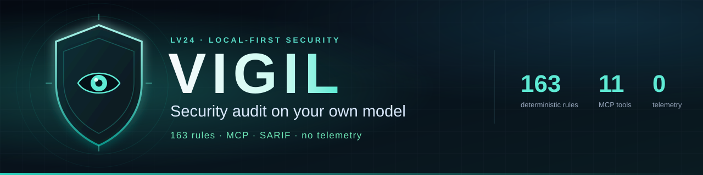

# Vigil

[](https://www.npmjs.com/package/lv24-vigil)
[](https://www.npmjs.com/package/lv24-vigil)
[](https://github.com/LevapVeeskela/lv24-vigil/releases)
[](LICENSE)
[](go.mod)
[](docs/mcp.md)
[](docs/providers.md)

**Docs:** English · [Русский](README.ru.md) · [Documentation](docs/) · [llms.txt](llms.txt)

> **Your code. Your model. Your findings.** Vigil runs 163 deterministic
> security rules over a repository, then — only if you ask — sends the minimum
> context to the model you already pay for to triage findings, review risky
> code, propose fixes and write a threat model. One static Go binary, one MCP
> server, no account, no telemetry, no Docker for a normal scan.

| 🚀 Start | 🧠 Use | 🛠 Operate |
| --- | --- | --- |
| [Install](#install) · [See it work](#see-it-work) · [Quickstart](#60-second-quickstart) | [MCP setup](#mcp-setup) · [For AI agents](#for-ai-agents) · [Providers](#providers) · [Rules](#rules) | [CI & SARIF](#ci-sarif-and-precheck) · [Safety](#safety) · [Docs](#documentation) |

> **Status: 0.5.x.** The deterministic engine, CLI and MCP server are usable
> today. LLM output is advisory, rule coverage keeps growing, and Vigil is not a
> replacement for a pentest. Treat every finding as a lead to verify, not a
> verdict.

## See it work

A nine-line Python file with a string-built SQL query and MD5 password hashing:

```text
$ vigil scan . --no-llm

vigil scan · .
  mode      standard
  model     deterministic rules only
  files     1 scanned, 0 skipped
  duration  2ms
  findings  2 high
  report    stdout

  HIGH     app.py:6  VGL-INJ-014 — SQL query built with Python string formatting
  HIGH     app.py:9  VGL-CRY-001 — Weak hash algorithm used for passwords or signatures
```

No key, no network, no Docker. Add a model and the same findings get triage,
context and a proposed diff:

```bash
export OPENAI_API_KEY=sk-...
vigil scan .
vigil fix VGL-XXXXXXXXXX          # print a unified diff
vigil fix VGL-XXXXXXXXXX --apply  # write it to the working tree, never commit
```

## Why Vigil

- **Your model, your keys.** OpenAI, Anthropic, Gemini, OpenRouter, Groq,
  DeepSeek, Mistral, xAI, OpenCode Go, Ollama, LM Studio, a local CLI or any
  OpenAI-compatible endpoint. No proxy, no Vigil account, no telemetry.
- **Deterministic first.** All 163 rules run before any model call. A provider
  outage cannot hide a hardcoded secret, a shell injection or a disabled JWT
  check.
- **Fits the agent you already use.** One stdio MCP server for OpenCode, Claude
  Code, Codex and Cursor. The agent can scan, explain, fix and re-check without
  leaving the conversation.
- **Read-only by default.** A scan never modifies source files; it writes only
  its own history under `.vigil/scans` or the user cache. `vigil fix --apply`
  writes a validated unified diff and never commits. Secrets are masked.
- **Small and portable.** One static Go binary, standard library plus
  `gopkg.in/yaml.v3`, no CGO, no Docker for the default scan.
- **CI-native.** Markdown, JSON, SARIF and HTML. `--fail-on high` exits `2`, so
  a pull request can block on a real finding.

## What you get

| | Feature | What it does |
| --- | --- | --- |
| 🔍 | **163 deterministic rules** | Secrets, injection, crypto, auth, web, config/IaC, CI and dependencies — no model required |
| 🧠 | **LLM triage** | Ranks and filters findings with your model; deterministic severity stays visible |
| 🧪 | **Deep review** | Reads bounded windows of high-risk files and adds `VGL-AI-001` findings |
| 🛠 | **Fix diffs** | Produces a validated unified diff; `--apply` writes the working tree only |
| 🗺 | **Threat model** | Generates a STRIDE-style Markdown threat model |
| 🔌 | **MCP server** | 11 tools, 4 resources and 3 prompts over stdio |
| 📊 | **Reports** | Markdown, JSON, SARIF 2.1.0 and self-contained HTML |
| 🧾 | **Baseline** | Suppresses accepted findings so only new issues fail a gate |
| 🧰 | **Command provider** | Reuses an already-authenticated local CLI without storing an API key |
| 📦 | **OSV, opt-in** | Queries `api.osv.dev` for dependency advisories; off by default |
| 🚦 | **CI gate** | `--fail-on`, exit code `2`, SARIF upload and `vigil precheck` |

## Install

**The only package you install is `lv24-vigil`.** It selects the binary for
your platform at install time and runs no install scripts.

```bash
npm i -g lv24-vigil@latest
vigil version
```

Or run it without a global install:

```bash
npx -y lv24-vigil scan --no-llm
npx -y lv24-vigil mcp
```

### Package choice

| Package | Install directly? | What it is |
| --- | --- | --- |
| **`lv24-vigil`** | ✅ **Yes** | Launcher, CLI and MCP server entry point; picks the right binary |
| `@lv24/vigil-<os>-<cpu>` | ❌ No | Platform binary (`win32`, `darwin`, `linux` × `x64`, `arm64`) pulled in as an `optionalDependency` |
| `lv24-vigil` on PyPI | Optional | Thin Python launcher that delegates to npm; needs Node.js 18+ |

The npm distribution is seven packages: one `lv24-vigil` launcher plus six
platform packages. Keep optional dependencies enabled — `--no-optional` and
`--omit=optional` skip the platform package, and `vigil` then exits with
`platform package ... is not installed`. Releases use npm Trusted Publishing
(OIDC) with a provenance attestation.

Requirements: Node.js 18+ for npm, Go 1.27+ for `go install`; release binaries
and installers need no runtime.

### Go

Go 1.27 or newer:

```bash
go install github.com/levapveeskela/lv24-vigil/cmd/vigil@latest
```

Make sure `$(go env GOPATH)/bin` is on `PATH`.

### Standalone installers

The installers resolve a release, verify the SHA-256 checksum, install
atomically and keep the previous binary:

```bash
git clone https://github.com/LevapVeeskela/lv24-vigil
cd lv24-vigil
bash installers/unix/install.sh          # macOS / Linux
.\installers\windows\install.ps1         # Windows PowerShell 5.1+
```

Each release also publishes six raw binaries and `checksums.txt` on the
[releases page](https://github.com/LevapVeeskela/lv24-vigil/releases). Options
and manual verification: [docs/install.md](docs/install.md).

### Container (local build)

There is no prebuilt Vigil image. Build the distroless Dockerfile from this
repository:

```bash
docker build -t lv24-vigil .
docker run --rm -v "$PWD:/workspace" -w /workspace lv24-vigil scan --no-llm
```

The image runs as a non-root user. Details: [docs/install.md](docs/install.md#container).

### Verify

```bash
vigil version   # build metadata
vigil status    # resolved provider, model, rules, store and last scan
vigil rules     # the authoritative rule catalog
```

## 60-second quickstart

```bash
cd your-repo

# Deterministic rules only: no key, no network.
vigil scan --no-llm

# Add LLM triage with a hosted model.
export OPENAI_API_KEY=sk-...
vigil scan

# Or keep everything local.
VIGIL_PROVIDER=ollama VIGIL_MODEL=qwen2.5-coder:14b vigil scan
```

Useful next commands:

```bash
vigil status --json                              # machine-readable environment check
vigil scan --format sarif --fail-on high         # CI gate, SARIF on stdout
vigil review --base origin/main --format sarif   # review only changed lines
vigil fix VGL-XXXXXXXXXX                         # proposed diff
vigil fix VGL-XXXXXXXXXX --apply                 # write it, never commit
vigil threat-model                               # STRIDE-style Markdown, needs a model
vigil report --format html > report.html         # render the last stored scan
```

`vigil scan` with no path scans the current directory. A finding ID comes from a
previous scan or report. Exit codes: `0` clean, `1` error, `2` findings at or
above `--fail-on`. Full reference: [docs/cli.md](docs/cli.md).

## MCP setup

Start the server with `vigil mcp` (stdio, JSON-RPC). Register it once:

**OpenCode** — `opencode.json` in the project root (or
`~/.config/opencode/opencode.json`):

```json
{
  "mcp": {
    "vigil": {
      "type": "local",
      "command": ["npx", "-y", "lv24-vigil", "mcp"],
      "enabled": true
    }
  }
}
```

**Claude Code**:

```bash
claude mcp add vigil -- npx -y lv24-vigil mcp
```

**Codex** — `~/.codex/config.toml`:

```toml
[mcp_servers.vigil]
command = "npx"
args = ["-y", "lv24-vigil", "mcp"]
```

**Cursor** — `~/.cursor/mcp.json`:

```json
{
  "mcpServers": {
    "vigil": {
      "command": "npx",
      "args": ["-y", "lv24-vigil", "mcp"]
    }
  }
}
```

If Vigil is installed globally, use `["vigil", "mcp"]` instead of `npx`. Start
the client from the repository you want to scan; `vigil mcp --root DIR` sets a
different project root.

The server exposes 11 tools — `vigil_scan`, `vigil_review`, `vigil_explain`,
`vigil_fix`, `vigil_threat_model`, `vigil_status`, `vigil_rules`,
`vigil_baseline`, `vigil_report`, `vigil_verify`, `vigil_history` — plus resources
`vigil://status`, `vigil://rules`, `vigil://scan/last`, `vigil://scan/<id>` and
prompts `security_review`, `threat_model`, `fix_finding`. Deterministic tools
work without a model; `vigil_fix` and `vigil_threat_model` need one and say so.
Only `vigil_fix` with `apply=true` changes source files.

Then ask your agent:

```text
Scan this repository with Vigil and explain the top three findings.
```

Client recipes and protocol details: [docs/mcp.md](docs/mcp.md) ·
[Cursor](examples/cursor.md) · [Claude Code](examples/claude-code.md) ·
[Codex](examples/codex.md).

## For AI agents

If you are an agent, these are the stable contracts. Prefer them over scraping
prose.

```json
{
  "package": "lv24-vigil",
  "install": "npm i -g lv24-vigil",
  "binary": "vigil",
  "mcp": { "command": "npx", "args": ["-y", "lv24-vigil", "mcp"] },
  "deterministic_only": "vigil scan --no-llm",
  "json_report": "vigil scan --format json",
  "sarif": "vigil scan --format sarif --fail-on high",
  "status_json": "vigil status --json",
  "fix_dry_run": "vigil fix <finding-id>",
  "fix_apply": "vigil fix <finding-id> --apply",
  "mcp_tools": [
    "vigil_scan", "vigil_review", "vigil_explain", "vigil_fix",
    "vigil_threat_model", "vigil_status", "vigil_rules", "vigil_baseline",
    "vigil_report", "vigil_verify", "vigil_history"
  ],
  "exit_codes": { "0": "clean", "1": "error", "2": "findings at or above --fail-on" },
  "docs_index": "llms.txt"
}
```

Rules that matter when you drive it:

1. **Install `lv24-vigil` only.** Never install `@lv24/vigil-<os>-<cpu>`
   directly; it is an optional dependency selected by the launcher.
2. **No model? Use `--no-llm`.** All 163 deterministic rules still run and
   produce findings. A missing model is a warning, not a failed scan.
3. **Do not parse the human summary.** Use `--format json`, `vigil status
   --json`, or an MCP tool. stdout carries the report; logs go to stderr.
4. **Fixes need confirmation.** Call `vigil_fix` with `apply=false` first, show
   the diff, and only then apply. Vigil never commits or stages.
5. **Respect the boundary.** Scan only the requested path. Do not upload code
   anywhere except the model endpoint the user configured.
6. **No telemetry.** There is no Vigil cloud, account, analytics or update
   check. `vigil precheck` is the only explicit upload and needs a staff JWT.

Full agent index: [`llms.txt`](llms.txt) · onboarding:
[`AGENTS.md`](AGENTS.md) · client recipes: [docs/mcp.md](docs/mcp.md).

## Providers

Set `VIGIL_PROVIDER` and the provider key, or let Vigil infer the provider from
a well-known key. Explicit `VIGIL_*` variables win over provider conventions.
A deterministic scan needs none of this.

| Provider | `VIGIL_PROVIDER` | Key variable | Default model |
| --- | --- | --- | --- |
| OpenAI | `openai` | `OPENAI_API_KEY` | `gpt-4.1-mini` |
| Anthropic | `anthropic` | `ANTHROPIC_API_KEY` | `claude-sonnet-4-5` |
| Google Gemini | `gemini` | `GEMINI_API_KEY` or `GOOGLE_API_KEY` | `gemini-2.5-flash` |
| OpenRouter | `openrouter` | `OPENROUTER_API_KEY` | `anthropic/claude-sonnet-4.5` |
| Groq | `groq` | `GROQ_API_KEY` | `llama-3.3-70b-versatile` |
| DeepSeek | `deepseek` | `DEEPSEEK_API_KEY` | `deepseek-chat` |
| Mistral | `mistral` | `MISTRAL_API_KEY` | `mistral-large-latest` |
| xAI | `xai` | `XAI_API_KEY` | `grok-4-fast` |
| OpenCode Go | `opencode-go` (alias `opencode`) | `OPENCODE_API_KEY` or `OPENCODE_GO_API_KEY` | `deepseek-v4.1-flash` |
| Ollama | `ollama` | none | `qwen2.5-coder:14b` |
| LM Studio | `lmstudio` | none | `local-model` |
| Local CLI | `command` | none | free-form label |
| OpenAI-compatible | `custom` | `VIGIL_API_KEY` | set `VIGIL_MODEL` |

Local models:

```bash
VIGIL_PROVIDER=ollama VIGIL_MODEL=qwen2.5-coder:14b vigil scan
VIGIL_PROVIDER=lmstudio VIGIL_MODEL=local-model vigil scan
```

The `command` provider reuses an already-authenticated local CLI — for example
`opencode run` — without storing an API key. Configure it in the **user** config:

```yaml
provider: command
model: opencode-go/deepseek-v4.1-flash
command: ["opencode", "run", "--format", "json", "--model", "opencode-go/deepseek-v4.1-flash", "--agent", "plan", "{prompt}"]
command_output: opencode-json
```

The CLI runs with your privileges; use a no-tools agent such as `--agent plan`.
A project `.vigil.yaml` cannot set `command` or `command_env` on purpose.
`OLLAMA_HOST` points at a non-default Ollama. `VIGIL_BASE_URL` overrides the
endpoint for any provider; `custom` requires it. Full reference:
[docs/providers.md](docs/providers.md) · keyless example:
[examples/config.command.yaml](examples/config.command.yaml).

## Rules

163 deterministic rules in eight families. They are pure: they read a file,
never write, never execute scanned code and never make a network call. The CLI is
the authoritative catalog:

```bash
vigil rules
```

| Family | Prefix | Rules | Looks for |
| --- | --- | ---: | --- |
| Secrets | `VGL-SEC` | 24 | Cloud keys, tokens, private keys, connection strings, `.env` leaks |
| Injection | `VGL-INJ` | 37 | SQL, shell, eval, XSS, deserialization, SSTI, prototype pollution |
| Crypto | `VGL-CRY` | 12 | Weak hashes/ciphers, ECB, static IVs, bad randomness, disabled TLS |
| Auth | `VGL-AUTH` | 16 | JWT verification, cookie flags, CORS with credentials, CSRF, defaults |
| Web | `VGL-WEB` | 17 | SSRF, path traversal, open redirect, headers, debug surfaces |
| Config / IaC | `VGL-CFG` | 28 | Docker, Compose, Kubernetes, Terraform, nginx, committed env files |
| CI | `VGL-CI` | 17 | Unpinned actions, `pull_request_target`, script injection, secret logs |
| Dependencies | `VGL-DEP` | 12 | Lockfiles, wildcard ranges, git/HTTP installs, TLS bypass |

Representative IDs: `VGL-SEC-002` (critical, AWS secret key), `VGL-INJ-019`
(critical, Java deserialization), `VGL-CRY-011` (critical, JWT `none`),
`VGL-AUTH-002` (critical, JWT verification disabled), `VGL-WEB-001` (high,
SSRF), `VGL-CFG-009` (high, Docker socket), `VGL-CI-002` (critical,
`pull_request_target` checkout), `VGL-DEP-006` (high, npm TLS off).

Model-only findings use `VGL-AI-001` and are marked as LLM-sourced. OSV findings
use `VGL-OSV-<advisory>` and appear only when `scan.osv` is enabled. Disable a
rule when it does not fit the project, not to make a report green:

```yaml
scan:
  disable_rules: [VGL-DEP-001]
```

Severity, confidence, baseline and masking details:
[docs/rules.md](docs/rules.md).

## Safety

- **Read-only by default.** A scan writes no source files; it writes only its
  scan history under `.vigil/scans` (or the user cache). The other write paths
  are `vigil fix --apply` / `vigil_fix apply=true`, the baseline command, an
  explicitly requested report file, `vigil init` and `vigil hook install`
  (`.git/hooks/<mode>` plus a `.pre-vigil.bak` backup with `--force`). A fix
  never commits and never stages.
- **Secrets are masked.** Detected credentials are redacted in evidence,
  snippets and reports. Raw secret values are never printed by the rule engine.
- **Your code goes only where you point it.** Deterministic scans make no
  network calls. LLM features send the minimum context needed to the endpoint
  you configured. Use a local model if code must not leave the machine.
- **Scanned code is untrusted.** Prompts delimit code as data, strip control
  characters and instruct the model to ignore instructions inside it. Model
  output is validated before it becomes a finding or a diff.
- **Fixes are checked before they land.** Paths must stay inside the repository
  (including through symlinks, junctions and hardlinks); binary and symlink
  patches and `.git` edits are rejected; hunk counts must match;
  `git apply --check` runs before any write.
- **No telemetry.** No Vigil cloud, account, analytics, crash reporter or update
  check. The only optional upload is `vigil precheck`, which needs an explicit
  staff JWT.

Details and limits: [docs/security-model.md](docs/security-model.md).

## Before commit / before deploy

One deterministic gate everywhere: `vigil scan --no-llm --fail-on high`. No
model, no key, no network.

| You want | Path | Setup |
| --- | --- | --- |
| Catch issues before a commit or push | Local git hook | `vigil hook install` |
| Block pull requests and `main` on GitHub | GitHub Actions | copy [`examples/github-workflow.yml`](examples/github-workflow.yml) |
| Block merge requests and `main` on GitLab | GitLab CI | copy [`examples/gitlab-ci.yml`](examples/gitlab-ci.yml) |
| Record evidence in the LV24 control plane | Optional pre-check | set `VIGIL_SECURITY_API_TOKEN` |

### Local hook (fastest, offline)

```bash
vigil hook install                  # pre-commit, fail on high
vigil hook install --mode pre-push  # before push instead
vigil hook status
vigil hook uninstall
```

The hook runs `vigil scan --changed --base HEAD --no-llm --fail-on high --quiet`
for a commit. A pre-push hook diffs against `@{upstream}` and falls back to
`HEAD~1` (then `HEAD` on a single-commit branch). It is marked
`# managed by lv24-vigil`, honours `VIGIL_BIN` (default `vigil`) and never
replaces a foreign hook without `--force`, which saves it as
`<hook>.pre-vigil.bak`. Uninstall removes only marked hooks and restores that
backup.

### GitHub Actions (PR, `main`, manual)

Copy [`examples/github-workflow.yml`](examples/github-workflow.yml) to
`.github/workflows/vigil.yml`:

```yaml
name: vigil
on:
  workflow_dispatch:
    inputs:
      fail-on:
        default: high
        type: choice
        options: [low, medium, high, critical]
  pull_request:
  push:
    branches: [main]

permissions:
  contents: read
  security-events: write

jobs:
  scan:
    runs-on: ubuntu-latest
    env:
      FAIL_ON: ${{ inputs['fail-on'] || 'high' }}
      VIGIL_SECURITY_API_TOKEN: ${{ secrets.VIGIL_SECURITY_API_TOKEN }}
      VIGIL_SECURITY_API: ${{ vars.VIGIL_SECURITY_API }}
    steps:
      - uses: actions/checkout@v7
      - uses: actions/setup-node@v7
        with: { node-version: 22 }
      - run: npm i -g lv24-vigil@latest
      - run: vigil scan . --no-llm --format sarif --output vigil.sarif --fail-on "$FAIL_ON"
      - if: always() && hashFiles('vigil.sarif') != ''
        uses: github/codeql-action/upload-sarif@v4
        with: { sarif_file: vigil.sarif }
      - if: always() && env.VIGIL_SECURITY_API_TOKEN != '' && hashFiles('vigil.sarif') != ''
        run: vigil precheck --sarif vigil.sarif --api "${VIGIL_SECURITY_API:-https://lv24.by/api}" --target "$GITHUB_REPOSITORY" --commit "$GITHUB_SHA"
```

The SARIF upload uses `if: always()` because `--fail-on` exits `2` after writing
the report. The pre-check is optional: without the secret the step is skipped.
`VIGIL_SECURITY_API_TOKEN` is a **staff JWT with `ops:security-scans`**, not an
API key; set the optional `VIGIL_SECURITY_API` repository variable only if your
control plane is not `https://lv24.by/api`.

### GitLab CI (MR, `main`, manual)

Copy [`examples/gitlab-ci.yml`](examples/gitlab-ci.yml) to `.gitlab-ci.yml`:

```yaml
vigil:
  image: node:22
  rules:
    - if: '$CI_PIPELINE_SOURCE == "merge_request_event"'
    - if: '$CI_PIPELINE_SOURCE == "web"'
      when: manual
    - if: '$CI_COMMIT_BRANCH == $CI_DEFAULT_BRANCH'
  variables:
    GIT_DEPTH: "0"
  script:
    - npm i -g lv24-vigil@latest
    - vigil scan . --no-llm --format sarif --output vigil.sarif --fail-on high
  artifacts:
    when: always
    paths: [vigil.sarif]
    reports:
      sarif: vigil.sarif
```

The optional pre-check runs when the `VIGIL_SECURITY_API_TOKEN` CI/CD variable
is set. `reports: sarif` is native SARIF ingestion (GitLab 19.2+ Ultimate); on
older instances keep the plain `paths` artifact and remove the `reports` block.
GitLab's `reports: sast` expects its own `gl-sast-report.json` schema, not
SARIF.

Full instructions, secrets, exit codes and SARIF details:
[docs/ci.md](docs/ci.md).

## CI, SARIF and precheck

```bash
vigil review --base origin/main --format sarif --fail-on high > vigil.sarif
```

Upload the result with `github/codeql-action/upload-sarif` and keep
`fetch-depth: 0`. The repository ships a composite action in `action.yml`; this
example uses the CLI directly so it also works on any runner:

```yaml
permissions:
  contents: read
  security-events: write

steps:
  - uses: actions/checkout@v7
    with: { fetch-depth: 0 }
  - run: npx -y lv24-vigil review --base origin/${{ github.base_ref }} --format sarif --fail-on high > vigil.sarif
    env:
      OPENAI_API_KEY: ${{ secrets.OPENAI_API_KEY }}
  - if: always()
    uses: github/codeql-action/upload-sarif@v4
    with: { sarif_file: vigil.sarif }
```

Fork pull requests do not receive repository secrets; without a key Vigil still
runs every deterministic rule and produces SARIF. `--fail-on high` exits `2`,
so the upload step must use `if: always()`.

With the LV24 security control plane, record the same SARIF as evidence before a
full assessment:

```bash
vigil precheck --sarif vigil.sarif --api "$SECURITY_API" --token "$STAFF_JWT" \
  --target "$GITHUB_REPOSITORY" --commit "$GITHUB_SHA"
```

`STAFF_JWT` is a staff JWT with `ops:security-scans`, not an API key. A precheck
does not start a scan. Full guide: [docs/ci.md](docs/ci.md) · example:
[examples/github-workflow.yml](examples/github-workflow.yml).

## Documentation

| Document | Contents |
| --- | --- |
| [docs/install.md](docs/install.md) | npm, Go, installers, binaries, container |
| [docs/cli.md](docs/cli.md) | Commands, flags, exit codes, formats |
| [docs/mcp.md](docs/mcp.md) | MCP clients, tools, resources, prompts |
| [docs/providers.md](docs/providers.md) | Providers, keys, local models, config precedence |
| [docs/rules.md](docs/rules.md) | Rule families, representative IDs, baseline |
| [docs/security-model.md](docs/security-model.md) | Egress, masking, prompt safety, limits |
| [docs/ci.md](docs/ci.md) | GitHub Actions, SARIF, fork PRs, prechecks |
| [docs/architecture.md](docs/architecture.md) | Packages, pipeline, design decisions |
| [docs/troubleshooting.md](docs/troubleshooting.md) | Common failures and fixes |
| [docs/comparison.md](docs/comparison.md) | Vigil vs Strix vs hosted scanners |
| [docs/release.md](docs/release.md) | Release pipeline, npm Trusted Publishing, re-runs |
| [docs/pypi.md](docs/pypi.md) | Python launcher and PyPI publishing |
| [docs/history.md](docs/history.md) | The `dist-0.1.4` incident and repository history |
| [docs/lv24-security-analysis.md](docs/lv24-security-analysis.md) | Strix upstream sync and the LV24 fork |
| [llms.txt](llms.txt) | Plain-text index for AI agents |
| [AGENTS.md](AGENTS.md) | Short onboarding for coding agents |

Russian overview: [README.ru.md](README.ru.md) · changes:
[CHANGELOG.md](CHANGELOG.md) · contributing: [CONTRIBUTING.md](CONTRIBUTING.md) ·
security reports: [SECURITY.md](SECURITY.md).

## License

Apache-2.0. See [LICENSE](LICENSE).
