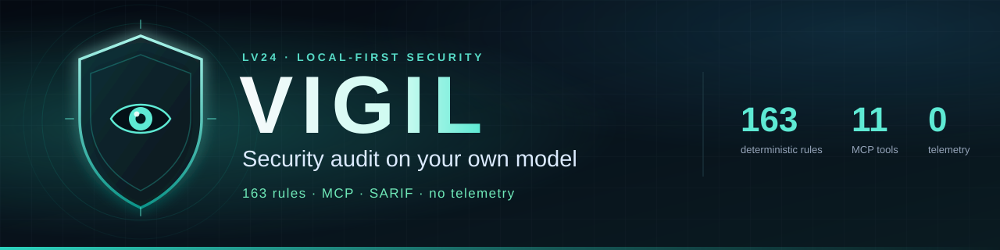

# Vigil

[](https://www.npmjs.com/package/lv24-vigil)
[](https://www.npmjs.com/package/lv24-vigil)
[](https://github.com/marketplace/actions/vigil-security-scan)
[](https://github.com/LevapVeeskela/lv24-vigil/releases)
[](LICENSE)
[](go.mod)
[](docs/mcp.md)
[](docs/providers.md)

**Документация:** [English](README.md) · Русский · [docs/](docs/) · [llms.txt](llms.txt)

> **Ваш код. Ваша модель. Ваши находки.** Vigil прогоняет 221 детерминированных
> правила по репозиторию, а затем — только если вы попросите — отправляет
> минимальный контекст в модель, за которую вы уже платите: триаж находок,
> разбор рискованного кода, предложения исправлений и модель угроз. Один
> статический бинарник на Go, один MCP-сервер, без аккаунта, телеметрии и Docker
> для обычного сканирования.

| 🚀 Старт | 🧠 Использование | 🛠 Эксплуатация |
| --- | --- | --- |
| [Установка](#установка) · [Посмотрите, как это работает](#посмотрите-как-это-работает) · [Быстрый старт](#быстрый-старт-за-60-секунд) | [Настройка MCP](#настройка-mcp) · [Для ИИ-агентов](#для-ии-агентов) · [Провайдеры](#провайдеры) · [Правила](#правила) | [CI и SARIF](#ci-sarif-и-precheck) · [Безопасность](#безопасность) · [Документация](#документация) |

> **Статус: 0.7.x.** Детерминированный движок, CLI и MCP-сервер уже можно
> использовать. Вывод модели носит рекомендательный характер, покрытие правил
> растёт, и Vigil не заменяет пентест. Любая находка — это повод проверить, а не
> готовый приговор.

## Посмотрите, как это работает

Python-файл на девять строк с SQL-запросом, собранным строкой, и MD5 для пароля:

```text
$ vigil scan . --no-llm

vigil scan · .
  mode      standard
  model     deterministic rules only
  files     1 scanned, 0 skipped
  duration  2ms
  findings  2 high
  report    stdout

  HIGH     app.py:6  VGL-INJ-014 — SQL query built with Python string formatting
  HIGH     app.py:9  VGL-CRY-001 — Weak hash algorithm used for passwords or signatures
```

Без ключа, сети и Docker. Добавьте модель — и те же находки получат триаж,
контекст и предложенный diff:

```bash
export OPENAI_API_KEY=sk-...
vigil scan .
vigil fix VGL-XXXXXXXXXX          # показать unified diff
vigil fix VGL-XXXXXXXXXX --apply  # записать в рабочее дерево, без коммита
```

## Почему Vigil

- **Ваша модель, ваши ключи.** OpenAI, Anthropic, Gemini, OpenRouter, Groq,
  DeepSeek, Mistral, xAI, OpenCode Go, Ollama, LM Studio, локальный CLI или любой
  OpenAI-совместимый endpoint. Без прокси, аккаунта Vigil и телеметрии.
- **Сначала детерминизм.** Все 221 правила отрабатывают до вызова модели. Сбой
  провайдера не спрячет захардкоженный секрет, shell-инъекцию или отключённую
  проверку JWT.
- **Встраивается в агента, которым вы уже пользуетесь.** Один stdio MCP-сервер
  для OpenCode, Claude Code, Codex и Cursor. Агент может сканировать, объяснять,
  чинить и перепроверять, не выходя из диалога.
- **По умолчанию только чтение.** Сканирование не меняет исходники; оно пишет
  только свою историю в `.vigil/scans` или пользовательский кэш. `vigil fix
  --apply` записывает проверенный unified diff и никогда не коммитит. Секреты
  маскируются.
- **Маленький и переносимый.** Один статический бинарник на Go, стандартная
  библиотека плюс `gopkg.in/yaml.v3`, без CGO и без Docker для обычного скана.
- **Дружит с CI.** Markdown, JSON, SARIF и HTML. `--fail-on high` завершает
  процесс с кодом `2`, чтобы pull request мог остановиться на реальной находке.

## Что вы получаете

| | Возможность | Что делает |
| --- | --- | --- |
| 🔍 | **221 детерминированных правила** | Секреты, инъекции, криптография, auth, web, config/IaC, CI, зависимости и anti-RE hardening — без модели |
| 🧠 | **LLM-триаж** | Ранжирует и фильтрует находки вашей моделью; детерминированная severity остаётся видимой |
| 🧪 | **Глубокий разбор** | Читает ограниченные окна рискованных файлов и добавляет находки `VGL-AI-001` |
| 🛠 | **Diff для фикса** | Готовит проверенный unified diff; `--apply` пишет только рабочее дерево |
| 🗺 | **Модель угроз** | Генерирует STRIDE-модель в Markdown |
| 🔌 | **MCP-сервер** | 13 инструментов, 4 ресурса и 5 промптов по stdio |
| 📊 | **Отчёты** | Markdown, JSON, SARIF 2.1.0 и самодостаточный HTML |
| 🧾 | **Baseline** | Подавляет принятые находки, чтобы гейт падал только на новых |
| 🧰 | **Провайдер `command`** | Переиспользует уже авторизованный локальный CLI без хранения API-ключа |
| 🛡 | **Проверка зависимостей** | Читает lockfile и запрашивает `api.osv.dev` по известным публичным advisory (сеть opt-in); `vigil_dependencies` |
| 🔒 | **Anti-RE hardening** | Ищет отсутствующую защиту релиза и поверхности, которые читает reverse-engineering-инструмент (REA): symbols/DWARF, Electron fuses, JS minify, WebView, Hermes, iOS testability, а также debug-подпись, debuggable, backup/cleartext, inspector и production source maps |
| 🚦 | **CI-гейт** | `--fail-on`, код выхода `2`, загрузка SARIF и `vigil precheck` |

## Установка

**Единственный пакет, который нужно ставить, — `lv24-vigil`.** При установке он
выбирает бинарник для вашей платформы и не запускает install-скрипты.

```bash
npm i -g lv24-vigil@latest
vigil version
```

Или без глобальной установки:

```bash
npx -y lv24-vigil scan --no-llm
npx -y lv24-vigil mcp
```

### Выбор пакета

| Пакет | Ставить напрямую? | Что это |
| --- | --- | --- |
| **`lv24-vigil`** | ✅ **Да** | Лаунчер, CLI и точка входа MCP; выбирает нужный бинарник |
| `@lv24/vigil-<os>-<cpu>` | ❌ Нет | Платформенный бинарник (`win32`, `darwin`, `linux` × `x64`, `arm64`) как `optionalDependency` |
| `lv24-vigil` на PyPI | Опционально | Тонкий Python-лаунчер, делегирует в npm; нужен Node.js 18+ |

В npm-дистрибутиве семь пакетов: лаунчер `lv24-vigil` и шесть платформенных.
Не отключайте optional dependencies — с `--no-optional` или `--omit=optional`
платформенный пакет не установится, и `vigil` завершится с ошибкой
`platform package ... is not installed`. Релизы публикуются через npm Trusted
Publishing (OIDC) с аттестацией происхождения.

Не пиньте `0.5.0`: тег и npm-пакет неизменяемы и всё ещё ставятся, но примеры
CI на этом теге устарели (`inputs.fail-on`, непроверенный GitLab pre-check).
Бинарники в порядке, шаблоны — нет. Используйте `0.7.1` или новее, либо
`@latest`.

Требования: Node.js 18+ для npm, Go 1.27+ для `go install`; готовым бинарникам и
установщикам среда выполнения не нужна.

### Go

Go 1.27 или новее:

```bash
go install github.com/levapveeskela/lv24-vigil/cmd/vigil@latest
```

Убедитесь, что `$(go env GOPATH)/bin` есть в `PATH`.

### Готовые установщики

Установщики находят релиз, проверяют SHA-256, ставят атомарно и сохраняют
предыдущий бинарник:

```bash
git clone https://github.com/LevapVeeskela/lv24-vigil
cd lv24-vigil
bash installers/unix/install.sh          # macOS / Linux
.\installers\windows\install.ps1         # Windows PowerShell 5.1+
```

Каждый релиз также публикует шесть готовых бинарников и `checksums.txt` на
[странице релизов](https://github.com/LevapVeeskela/lv24-vigil/releases). Опции
и ручная проверка: [docs/install.md](docs/install.md).

### Контейнер (локальная сборка)

Готового образа Vigil нет. Соберите distroless Dockerfile из этого репозитория:

```bash
docker build -t lv24-vigil .
docker run --rm -v "$PWD:/workspace" -w /workspace lv24-vigil scan --no-llm
```

Образ работает от непривилегированного пользователя. Подробности:
[docs/install.md](docs/install.md#container).

### Проверка

```bash
vigil version   # метаданные сборки
vigil status    # провайдер, модель, правила, хранилище и последний скан
vigil rules     # авторитетный каталог правил
```

## Быстрый старт за 60 секунд

```bash
cd your-repo

# Только детерминированные правила: без ключа и сети.
vigil scan --no-llm

# Добавить LLM-триаж с облачной моделью.
export OPENAI_API_KEY=sk-...
vigil scan

# Или оставить всё локально.
VIGIL_PROVIDER=ollama VIGIL_MODEL=qwen2.5-coder:14b vigil scan
```

Что дальше:

```bash
vigil status --json                              # проверка окружения для машин
vigil scan --format sarif --fail-on high         # CI-гейт, SARIF в stdout
vigil review --base origin/main --format sarif   # только изменённые строки
vigil fix VGL-XXXXXXXXXX                         # предложенный diff
vigil fix VGL-XXXXXXXXXX --apply                 # записать, без коммита
vigil threat-model                               # STRIDE-модель в Markdown, нужна модель
vigil report --format html > report.html         # отрисовать последний скан
```

`vigil scan` без пути сканирует текущий каталог. ID находки берётся из
предыдущего скана или отчёта. Коды выхода: `0` — чисто, `1` — ошибка, `2` —
находки на уровне `--fail-on` или выше. Полный справочник:
[docs/cli.md](docs/cli.md).

## Настройка MCP

Сервер запускается командой `vigil mcp` (stdio, JSON-RPC). Зарегистрируйте его
один раз:

**OpenCode** — `opencode.json` в корне проекта (или
`~/.config/opencode/opencode.json`):

```json
{
  "mcp": {
    "vigil": {
      "type": "local",
      "command": ["npx", "-y", "lv24-vigil", "mcp"],
      "enabled": true
    }
  }
}
```

**Claude Code**:

```bash
claude mcp add vigil -- npx -y lv24-vigil mcp
```

**Codex** — `~/.codex/config.toml`:

```toml
[mcp_servers.vigil]
command = "npx"
args = ["-y", "lv24-vigil", "mcp"]
```

**Cursor** — `~/.cursor/mcp.json`:

```json
{
  "mcpServers": {
    "vigil": {
      "command": "npx",
      "args": ["-y", "lv24-vigil", "mcp"]
    }
  }
}
```

Если Vigil установлен глобально, используйте `["vigil", "mcp"]` вместо `npx`.
Запускайте клиент из репозитория, который хотите сканировать;
`vigil mcp --root DIR` задаёт другой корень проекта.

Сервер отдаёт 13 инструментов — `vigil_scan`, `vigil_review`, `vigil_explain`,
`vigil_fix`, `vigil_threat_model`, `vigil_status`, `vigil_rules`, `vigil_hardening`, `vigil_dependencies`,
`vigil_baseline`, `vigil_report`, `vigil_verify`, `vigil_history` — а также
ресурсы `vigil://status`, `vigil://rules`, `vigil://scan/last`,
`vigil://scan/<id>` и промпты `security_review`, `threat_model`,
`fix_finding`, `anti_re_hardening`, `dependency_audit`. Детерминированные инструменты работают без модели; `vigil_fix`
и `vigil_threat_model` требуют её и явно об этом сообщают. Только `vigil_fix`
с `apply=true` меняет исходники.

Дальше можно попросить агента:

```text
Просканируй этот репозиторий через Vigil и объясни три главные находки.
```

Рецепты для клиентов и детали протокола: [docs/mcp.md](docs/mcp.md) ·
[Cursor](examples/cursor.md) · [Claude Code](examples/claude-code.md) ·
[Codex](examples/codex.md).

## Для ИИ-агентов

Если вы агент, это стабильные контракты. Предпочитайте их чтению прозы.

```json
{
  "package": "lv24-vigil",
  "install": "npm i -g lv24-vigil",
  "binary": "vigil",
  "mcp": { "command": "npx", "args": ["-y", "lv24-vigil", "mcp"] },
  "deterministic_only": "vigil scan --no-llm",
  "json_report": "vigil scan --format json",
  "sarif": "vigil scan --format sarif --fail-on high",
  "status_json": "vigil status --json",
  "fix_dry_run": "vigil fix <finding-id>",
  "fix_apply": "vigil fix <finding-id> --apply",
  "mcp_tools": [
    "vigil_scan", "vigil_review", "vigil_explain", "vigil_fix",
    "vigil_threat_model", "vigil_status", "vigil_rules", "vigil_baseline",
    "vigil_report", "vigil_verify", "vigil_history"
  ],
  "exit_codes": { "0": "clean", "1": "error", "2": "findings at or above --fail-on" },
  "docs_index": "llms.txt"
}
```

Правила, которые важны при управлении:

1. **Ставьте только `lv24-vigil`.** Никогда не устанавливайте
   `@lv24/vigil-<os>-<cpu>` напрямую: это optional dependency, который выбирает
   лаунчер.
2. **Нет модели? Используйте `--no-llm`.** Все 221 детерминированных правила
   всё равно отработают и дадут находки. Отсутствие модели — предупреждение, а
   не проваленный скан.
3. **Не парсите человеческую сводку.** Используйте `--format json`,
   `vigil status --json` или MCP-инструмент. stdout — это отчёт, логи идут в
   stderr.
4. **Фиксы требуют подтверждения.** Сначала `vigil_fix` с `apply=false`,
   покажите diff и только потом применяйте. Vigil никогда не коммитит и не
   делает staging.
5. **Уважайте границу.** Сканируйте только запрошенный путь. Не отправляйте код
   никуда, кроме endpoint модели, который настроил пользователь.
6. **Телеметрии нет.** Нет облака Vigil, аккаунта, аналитики и проверки
   обновлений. Единственная явная отправка — `vigil precheck`, и для неё нужен
   staff JWT.

Полный индекс для агентов: [`llms.txt`](llms.txt) · онбординг:
[`AGENTS.md`](AGENTS.md) · рецепты клиентов: [docs/mcp.md](docs/mcp.md).

## Провайдеры

Укажите `VIGIL_PROVIDER` и ключ провайдера — или дайте Vigil определить
провайдера по известному ключу. Явные переменные `VIGIL_*` важнее соглашений
провайдера. Детерминированному скану ничего из этого не нужно.

| Провайдер | `VIGIL_PROVIDER` | Переменная ключа | Модель по умолчанию |
| --- | --- | --- | --- |
| OpenAI | `openai` | `OPENAI_API_KEY` | `gpt-4.1-mini` |
| Anthropic | `anthropic` | `ANTHROPIC_API_KEY` | `claude-sonnet-4-5` |
| Google Gemini | `gemini` | `GEMINI_API_KEY` или `GOOGLE_API_KEY` | `gemini-2.5-flash` |
| OpenRouter | `openrouter` | `OPENROUTER_API_KEY` | `anthropic/claude-sonnet-4.5` |
| Groq | `groq` | `GROQ_API_KEY` | `llama-3.3-70b-versatile` |
| DeepSeek | `deepseek` | `DEEPSEEK_API_KEY` | `deepseek-chat` |
| Mistral | `mistral` | `MISTRAL_API_KEY` | `mistral-large-latest` |
| xAI | `xai` | `XAI_API_KEY` | `grok-4-fast` |
| OpenCode Go | `opencode-go` (алиас `opencode`) | `OPENCODE_API_KEY` или `OPENCODE_GO_API_KEY` | `deepseek-v4.1-flash` |
| Ollama | `ollama` | не нужен | `qwen2.5-coder:14b` |
| LM Studio | `lmstudio` | не нужен | `local-model` |
| Локальный CLI | `command` | не нужен | произвольная метка |
| OpenAI-совместимый | `custom` | `VIGIL_API_KEY` | задайте `VIGIL_MODEL` |

Локальные модели:

```bash
VIGIL_PROVIDER=ollama VIGIL_MODEL=qwen2.5-coder:14b vigil scan
VIGIL_PROVIDER=lmstudio VIGIL_MODEL=local-model vigil scan
```

Провайдер `command` переиспользует уже авторизованный локальный CLI (например,
`opencode run`) и не хранит API-ключ. Настройте его в **пользовательском**
конфиге:

```yaml
provider: command
model: opencode-go/deepseek-v4.1-flash
command: ["opencode", "run", "--format", "json", "--model", "opencode-go/deepseek-v4.1-flash", "--agent", "plan", "{prompt}"]
command_output: opencode-json
```

Команда выполняется с вашими правами; используйте агент без инструментов
(`--agent plan`). Проектный `.vigil.yaml` намеренно не может задать `command`
или `command_env`. `OLLAMA_HOST` указывает на нестандартный Ollama.
`VIGIL_BASE_URL` переопределяет endpoint любого провайдера; для `custom` он
обязателен. Полный справочник: [docs/providers.md](docs/providers.md) · пример
без ключа: [examples/config.command.yaml](examples/config.command.yaml).

## Правила

221 детерминированных правила в девяти семействах. Они чистые: читают файл,
ничего не пишут, не исполняют сканируемый код и не делают сетевых вызовов.
Авторитетный каталог — CLI:

```bash
vigil rules
```

| Семейство | Префикс | Правил | Что ищет |
| --- | --- | ---: | --- |
| Секреты | `VGL-SEC` | 29 | Ключи облаков, токены, приватные ключи, строки подключения, утечки `.env` |
| Инъекции | `VGL-INJ` | 47 | SQL, shell, eval, XSS, десериализация, SSTI, prototype pollution |
| Криптография | `VGL-CRY` | 16 | Слабые хэши/шифры, ECB, статические IV, плохая случайность, отключённый TLS |
| Аутентификация | `VGL-AUTH` | 17 | Проверка JWT, флаги cookie, CORS с credentials, CSRF, пароли по умолчанию |
| Web | `VGL-WEB` | 18 | SSRF, path traversal, open redirect, заголовки, debug-поверхности |
| Конфигурация / IaC | `VGL-CFG` | 37 | Docker, Compose, Kubernetes, Terraform, nginx, закоммиченные env-файлы |
| CI | `VGL-CI` | 19 | Незапиненные actions, `pull_request_target`, инъекции в скрипты, секреты в логах |
| Зависимости | `VGL-DEP` | 15 | Lockfile, wildcard-версии, git/HTTP-установки, отключённый TLS |
| Anti-RE | `VGL-ARE` | 23 | Отсутствующая защита mobile/desktop: обфускация релиза, debug-подпись, debuggable, backup/cleartext, plist-исключения, inspector, source maps, а также Rust symbols/DWARF, .NET, iOS testability и symbols, Electron fuses/ASAR, JS minify, WebView и Hermes. Маппинг: [docs/anti-re-hardening.md](docs/anti-re-hardening.md) |

Примеры ID: `VGL-SEC-002` (critical, AWS secret key), `VGL-INJ-019` (critical,
десериализация Java), `VGL-CRY-011` (critical, JWT `none`), `VGL-AUTH-002`
(critical, отключена проверка JWT), `VGL-WEB-001` (high, SSRF), `VGL-CFG-009`
(high, Docker socket), `VGL-CI-002` (critical, `pull_request_target` checkout),
`VGL-DEP-006` (high, отключён TLS в npm), `VGL-ARE-003` (high, debuggable
Android manifest), `VGL-ARE-010` (high, iOS `get-task-allow`).

Находки только от модели помечаются `VGL-AI-001` и имеют источник LLM. Находки
OSV используют `VGL-OSV-<advisory>` и появляются только при `scan.osv: true`.
Отключайте правило, когда оно не подходит проекту, а не чтобы отчёт стал
зелёным:

```yaml
scan:
  disable_rules: [VGL-DEP-001]
```

Severity, confidence, baseline и маскирование: [docs/rules.md](docs/rules.md).

## Безопасность

- **По умолчанию только чтение.** Скан не пишет исходники; он пишет только
  историю сканов в `.vigil/scans` (или пользовательский кэш). Остальные пути
  записи: `vigil fix --apply` / `vigil_fix apply=true`, команда baseline, явно
  запрошенный файл отчёта, `vigil init` и `vigil hook install`
  (`.git/hooks/<mode>`, бэкап `.pre-vigil.bak` при замене чужого хука с
  `--force`). Фикс никогда не коммитит и не делает
  staging.
- **Секреты маскируются.** Найденные учётные данные редактируются в evidence,
  сниппетах и отчётах. Сырые значения секретов движок правил не печатает.
- **Код уходит только туда, куда вы указали.** Детерминированный скан не делает
  сетевых вызовов. LLM-функции отправляют минимальный нужный контекст на
  настроенный endpoint. Если код не должен покидать машину — используйте
  локальную модель.
- **Сканируемый код — недоверенный.** Промпты обрамляют код как данные, вырезают
  управляющие символы и требуют игнорировать инструкции внутри кода. Вывод
  модели проверяется, прежде чем стать находкой или diff-ом.
- **Фиксы проверяются до записи.** Пути обязаны оставаться внутри репозитория
  (включая symlink, junction и hardlink); бинарные и symlink-патчи и правки
  `.git` отклоняются; счётчики строк в hunk-ах должны совпадать;
  `git apply --check` выполняется до любой записи.
- **Телеметрии нет.** Нет облака Vigil, аккаунта, аналитики, crash reporter и
  проверки обновлений. Единственная опциональная отправка — `vigil precheck`,
  для неё нужен явный staff JWT.

Детали и ограничения: [docs/security-model.md](docs/security-model.md).

## Перед коммитом / перед деплоем

Единый детерминированный гейт: `vigil scan --no-llm --fail-on high`. Без модели,
без ключа, без сети.

| Задача | Путь | Настройка |
| --- | --- | --- |
| Поймать проблему до коммита или пуша | Локальный git-хук | `vigil hook install` |
| Блокировать pull request и `main` на GitHub | GitHub Actions | скопировать [`examples/github-workflow.yml`](examples/github-workflow.yml) |
| Блокировать merge request и `main` на GitLab | GitLab CI | скопировать [`examples/gitlab-ci.yml`](examples/gitlab-ci.yml) |
| Записать evidence в control plane LV24 | Опциональный pre-check | задать `VIGIL_SECURITY_API_TOKEN` |

### Локальный хук (быстро, офлайн)

```bash
vigil hook install                  # pre-commit, падать на high
vigil hook install --mode pre-push  # или перед пушем
vigil hook status
vigil hook uninstall
```

Хук коммита запускает `vigil scan --changed --base HEAD --no-llm --fail-on high --quiet`.
Хук пуша сравнивает с `@{upstream}` и откатывается на `HEAD~1` (затем `HEAD` в
ветке с одним коммитом). Файл помечен `# managed by lv24-vigil`, учитывает
`VIGIL_BIN` (по умолчанию `vigil`) и не заменяет чужой хук без `--force`;
старый хук сохраняется как `<hook>.pre-vigil.bak`. `uninstall` удаляет только
хуки Vigil и возвращает бэкап.

### GitHub Actions (PR, `main`, вручную)

Действие также опубликовано в [GitHub Marketplace](https://github.com/marketplace/actions/vigil-security-scan). Используйте `uses: LevapVeeskela/lv24-vigil@v0.7.1`; добавьте `version: 0.7.1`, если CLI должен совпадать с тегом действия.

Скопируйте [`examples/github-workflow.yml`](examples/github-workflow.yml) в
`.github/workflows/vigil.yml`:

```yaml
name: vigil
on:
  workflow_dispatch:
    inputs:
      fail-on:
        default: high
        type: choice
        options: [low, medium, high, critical]
  pull_request:
  push:
    branches: [main]

permissions:
  contents: read
  security-events: write

jobs:
  scan:
    runs-on: ubuntu-latest
    env:
      FAIL_ON: ${{ inputs['fail-on'] || 'high' }}
      VIGIL_SECURITY_API_TOKEN: ${{ secrets.VIGIL_SECURITY_API_TOKEN }}
      VIGIL_SECURITY_API: ${{ vars.VIGIL_SECURITY_API }}
    steps:
      - uses: actions/checkout@v7
      - uses: actions/setup-node@v7
        with: { node-version: 22 }
      - run: npm i -g lv24-vigil@latest
      - run: vigil scan . --no-llm --format sarif --output vigil.sarif --fail-on "$FAIL_ON"
      - if: always() && hashFiles('vigil.sarif') != ''
        uses: github/codeql-action/upload-sarif@v4
        with: { sarif_file: vigil.sarif }
      - if: always() && env.VIGIL_SECURITY_API_TOKEN != '' && hashFiles('vigil.sarif') != ''
        run: vigil precheck --sarif vigil.sarif --api "${VIGIL_SECURITY_API:-https://lv24.by/api}" --target "$GITHUB_REPOSITORY" --commit "$GITHUB_SHA"
```

SARIF загружается с `if: always()`, потому что `--fail-on` завершает процесс с
кодом `2` уже после записи отчёта. Pre-check опционален: без секрета шаг
пропускается. `VIGIL_SECURITY_API_TOKEN` — это **staff JWT со scope
`ops:security-scans`**, не API-ключ. Переменная `VIGIL_SECURITY_API` нужна,
только если control plane отличается от `https://lv24.by/api`.

### GitLab CI (MR, `main`, вручную)

Скопируйте [`examples/gitlab-ci.yml`](examples/gitlab-ci.yml) в `.gitlab-ci.yml`:

```yaml
vigil:
  image: node:22
  rules:
    - if: '$CI_PIPELINE_SOURCE == "merge_request_event"'
    - if: '$CI_PIPELINE_SOURCE == "web"'
      when: manual
    - if: '$CI_COMMIT_BRANCH == $CI_DEFAULT_BRANCH'
  variables:
    GIT_DEPTH: "0"
  script:
    - npm i -g lv24-vigil@latest
    - vigil scan . --no-llm --format sarif --output vigil.sarif --fail-on high
  artifacts:
    when: always
    paths: [vigil.sarif]
    reports:
      sarif: vigil.sarif
```

Pre-check запускается, если задана CI/CD-переменная
`VIGIL_SECURITY_API_TOKEN`. `reports: sarif` — нативная загрузка SARIF
(GitLab 19.2+ Ultimate); в старых версиях оставьте обычный артефакт `paths` и
уберите блок `reports`. `reports: sast` в GitLab ожидает собственный формат
`gl-sast-report.json`, а не SARIF.

Полные инструкции, секреты, коды выхода и SARIF: [docs/ci.md](docs/ci.md).

## CI, SARIF и precheck

```bash
vigil review --base origin/main --format sarif --fail-on high > vigil.sarif
```

Загрузите результат через `github/codeql-action/upload-sarif` и не забудьте
`fetch-depth: 0`. В репозитории есть composite action `action.yml`; пример ниже
вызывает CLI напрямую, поэтому работает на любом runner:

```yaml
permissions:
  contents: read
  security-events: write

steps:
  - uses: actions/checkout@v7
    with: { fetch-depth: 0 }
  - run: npx -y lv24-vigil review --base origin/${{ github.base_ref }} --format sarif --fail-on high > vigil.sarif
    env:
      OPENAI_API_KEY: ${{ secrets.OPENAI_API_KEY }}
  - if: always()
    uses: github/codeql-action/upload-sarif@v4
    with: { sarif_file: vigil.sarif }
```

Pull request из форка не получает секреты репозитория; без ключа Vigil всё равно
прогоняет все детерминированные правила и формирует SARIF. `--fail-on high`
завершает процесс с кодом `2`, поэтому шаг загрузки должен использовать
`if: always()`.

При наличии контрольной плоскости безопасности LV24 запишите тот же SARIF как
доказательство перед полной проверкой:

```bash
vigil precheck --sarif vigil.sarif --api "$SECURITY_API" --token "$STAFF_JWT" \
  --target "$GITHUB_REPOSITORY" --commit "$GITHUB_SHA"
```

`STAFF_JWT` — это staff JWT со scope `ops:security-scans`, а не API-ключ.
Precheck не запускает скан. Полное руководство: [docs/ci.md](docs/ci.md) ·
пример: [examples/github-workflow.yml](examples/github-workflow.yml).

## Документация

| Документ | Содержание |
| --- | --- |
| [docs/install.md](docs/install.md) | npm, Go, установщики, бинарники, контейнер |
| [docs/cli.md](docs/cli.md) | Команды, флаги, коды выхода, форматы |
| [docs/mcp.md](docs/mcp.md) | MCP-клиенты, инструменты, ресурсы, промпты |
| [docs/providers.md](docs/providers.md) | Провайдеры, ключи, локальные модели, приоритет настроек |
| [docs/rules.md](docs/rules.md) | Семейства правил, примеры ID, baseline |
| [docs/security-model.md](docs/security-model.md) | Сеть, маскирование, безопасность промптов, границы |
| [docs/ci.md](docs/ci.md) | GitHub Actions, SARIF, форки, precheck |
| [docs/architecture.md](docs/architecture.md) | Пакеты, конвейер, решения |
| [docs/troubleshooting.md](docs/troubleshooting.md) | Типовые ошибки и решения |
| [docs/comparison.md](docs/comparison.md) | Vigil, Strix и облачные сканеры |
| [docs/release.md](docs/release.md) | Релизный конвейер, npm Trusted Publishing, повторные запуски |
| [docs/pypi.md](docs/pypi.md) | Python-лаунчер и публикация на PyPI |
| [docs/history.md](docs/history.md) | Инцидент `dist-0.1.4` и история репозитория |
| [docs/lv24-security-analysis.md](docs/lv24-security-analysis.md) | Синхронизация Strix и форк LV24 |
| [llms.txt](llms.txt) | Плоский индекс для ИИ-агентов |
| [AGENTS.md](AGENTS.md) | Короткий онбординг для кодовых агентов |

Английская версия: [README.md](README.md) · изменения:
[CHANGELOG.md](CHANGELOG.md) · участие: [CONTRIBUTING.md](CONTRIBUTING.md) ·
уязвимости: [SECURITY.md](SECURITY.md).

## Лицензия

Apache-2.0. См. [LICENSE](LICENSE).
