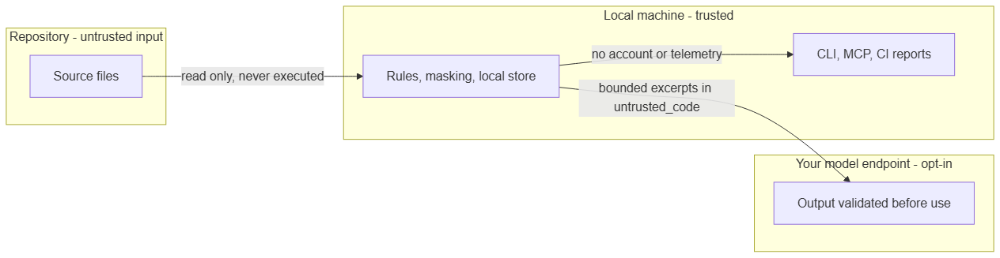
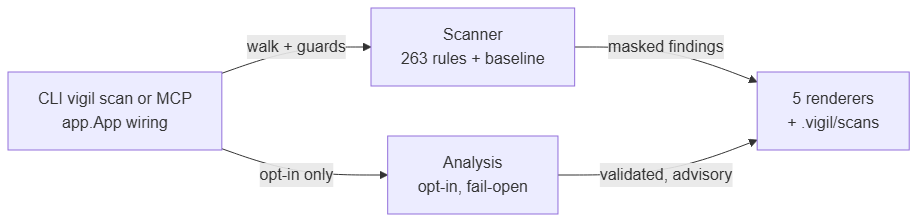
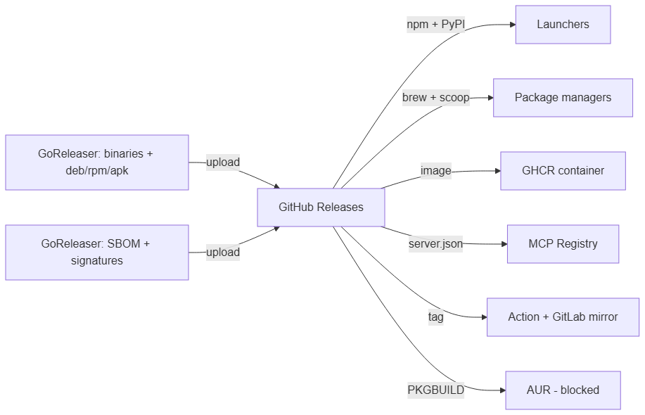

# Architecture — Vigil

Vigil turns a repository into a small, reviewable set of security findings, locally and
repeatably. The deterministic engine is the product; an optional model adds context and never
becomes a dependency.

**Deep dive:** [architecture-deep-dive.md](architecture-deep-dive.md) (packages, design decisions, limits) ·
**Docs index:** [README.md](README.md) · **Agent entry:** [../AGENTS.md](../AGENTS.md) ·
**Diagrams:** [architecture/README.md](architecture/README.md)

## 1. Purpose and scope

What it does:

- Scans a tree with 263 deterministic rules across ten families: secrets, injection, crypto,
  auth, web, config/IaC, CI, dependencies, anti-RE hardening and MCP configuration.
- Masks secrets, applies inline suppressions and a baseline, and renders stable findings.
- Optionally calls the user's own model for triage, deep review, fix proposals and a threat
  model — with bounded context and validated output.
- Ships as one static Go binary with a CLI and a stdio MCP server that share one engine.

What it explicitly does not do: no cross-file data-flow analysis, no exploit execution, no
dynamic testing, no SaaS, no account, no telemetry by default, no team aggregation. LLM output
is advisory and model-dependent. A clean scan is not proof of safety.

## 2. System context and trust boundaries

| Actor / system | Relationship |
|---|---|
| Developer / CI | Runs `vigil scan`; owns the exit code and the baseline decision |
| MCP client (agent) | Spawns `vigil mcp` over stdio; no listening port |
| Scanned repository | **Untrusted input**: code is read, never executed |
| User's model endpoint | **Opt-in egress**; the only place code excerpts can go |
| GitHub Releases, npm, PyPI, GHCR | Distribution only; no runtime dependency |
| `api.osv.dev` | Explicit opt-in lookup in `vigil dependencies` / `vigil_dependencies` |
| LV24 control plane | Only `vigil precheck`, with a staff JWT (`ops:security-scans`) |

Trust rules:

- Deterministic scans make **no network calls**. No upload endpoint, no account, no analytics.
- Code excerpts are data. Every prompt wraps them in `<untrusted_code>` and strips control
  characters; the model is told to ignore instructions found inside.
- A committed `.vigil.yaml` is repository content: it cannot set a key, endpoint or command.
- The MCP server opens no port. It reads JSON-RPC from stdin and writes to stdout.

## 3. Runtime components

| Component | Responsibility | Entry file | Store / port |
|---|---|---|---|
| CLI | Commands, flags, exit codes, hooks, reports | `cmd/vigil` | none |
| MCP server | JSON-RPC over stdio, tools/resources/prompts | `internal/mcp`, `internal/tools` | none |
| `app` | Composition root wiring config, registry, scanner, analyzer, store | `internal/app` | — |
| `config` | Defaults, user config, project config, env, validation | `internal/config` | YAML files |
| `scanner` | Walk, ignore, caps, binary/symlink/hardlink guards, diff mode, baseline | `internal/scanner` | — |
| `rules` | Rule interface, registry, ten packs, secret masking | `internal/rules` | — |
| `model` | `Finding`, `ScanResult`, `Severity`, `Confidence`, `Fix`, `Location` | `internal/model` | — |
| `analysis` | Triage, deep review, explain, fix proposal, threat model, diff validation | `internal/analysis` | — |
| `llm` | OpenAI-compatible, Anthropic and Gemini clients; retries; typed errors | `internal/llm` | HTTPS only |
| `report` | Five pure renderers: Markdown, JSON, SARIF, JUnit, HTML | `internal/report` | — |
| `store` | Scan history, atomic writes, 50-scan retention | `internal/store` | `.vigil/scans` |
| `mcpaudit` | Offline MCP config discovery and `VGL-MCP` posture audit | `internal/mcpaudit` | reads config |
| `sbom` | CycloneDX 1.6 / SPDX 2.3 inventory from manifests | `internal/sbom` | — |
| `gitutil` | Repo root, changed files, unified diff, `git apply --check`, apply | `internal/gitutil` | git CLI |
| `safepath` | Repo-relative path validation, symlink/junction-safe resolution | `internal/safepath` | — |
| `version` | Build metadata injected with `-ldflags` | `internal/version` | — |

Dependencies point inward: `rules` and `model` know nothing about the CLI, MCP or a provider.
`app` is the composition root. `go.mod` requires Go 1.27 and one dependency,
`gopkg.in/yaml.v3`.

## 4. Surfaces: CLI and MCP

| Surface | Shape | Safety posture |
|---|---|---|
| `vigil scan` | Flags, config, formats, `--fail-on`, exit codes 0/1/2 | Read-only; writes only the store or an explicit report |
| `vigil mcp` | Stdio JSON-RPC; 14 tools, 4 resources, 5 prompts | No listening port; read-only and offline modes |
| `vigil_fix` | Returns a validated diff; `mode=apply` writes the tree | Never commits, stages or pushes |
| `vigil_precheck` | Optional evidence upload | Needs a staff JWT; never starts a scan |

Both surfaces call the same `app.App`. Tool handlers live in `internal/tools`; the MCP package is
transport only, so CLI and MCP behavior cannot drift. Protocol versions `2025-06-18`,
`2025-03-26` and `2024-11-05` are accepted; an unknown version falls back to the newest.

Path+line addressing, typed errors and bounded output are contractual in 0.11: a tool returns a
stable finding path and range, truncation is explicit (`stats.findingsTruncated`), and accepted
findings appear in `suppressed` rather than disappearing.

## 5. Key flow: scan pipeline

1. **Entry.** The CLI or an MCP tool calls `app.App` with a root, config and mode.
2. **Config.** Defaults → user config → project `.vigil.yaml` → environment; validation fails
   fast, and project config cannot set credentials or commands.
3. **Walk.** Hard-coded directories (`.git`, `node_modules`, `vendor`, `dist`, `build`,
   `target`, virtualenvs, caches, `.vigil`) are skipped; ignore rules apply.
4. **Guards.** Files above `scan.max_file_bytes` (2 MiB default, 64 MiB cap) are skipped; binary
   content is sniffed; symlinks are skipped unless `scan.follow_symlinks`, with cycle checks;
   files with more than one hardlink are skipped because the inode can live outside the tree.
5. **Rules.** A worker pool evaluates 263 line-oriented rules with small windows for multi-line
   calls. The result is sorted by severity, confidence, path and line.
6. **Suppression.** Inline `vigil:ignore` directives and the baseline move accepted findings to
   `suppressed`; nothing is deleted. A finding ID hashes rule ID, clean path, start line and
   normalised evidence; a fingerprint drops the line so small moves stay the same finding.
7. **Optional analysis.** Only when a provider is configured. Fail-open: errors go to
   `ScanResult.Errors`, deterministic findings remain, and the scan still finishes.
8. **Output.** A pure renderer produces bytes; the store writes JSON atomically; the CLI returns
   exit code `2` when findings meet `--fail-on`.

## 6. Deterministic engine

- **263 rules / ten families:** secrets 37, injection 54, crypto 16, auth 19, web 22, config/IaC
  42, CI 20, dependencies 15, anti-RE 28, MCP 10. IDs are `VGL-<FAMILY>-NNN`; model-only
  findings use `VGL-AI-001`, OSV findings `VGL-OSV-<advisory>`.
- **Line-oriented by design.** A full data-flow engine would be larger, slower and harder to keep
  free of false positives; the optional deep review covers some multi-line cases.
- **Baseline.** Entries can carry a ticket, path scope and expiry. `prune` removes expired
  entries, which stop suppressing immediately. Baseline parity is enforced across CLI and MCP.
- **Masking.** Detected credentials are redacted in evidence, snippets and every renderer. Raw
  secret values are never printed by the rule engine.
- **Diff mode.** `vigil scan --diff -` scans only changed lines for hooks and CI, using the same
  rules and baseline.

## 7. Optional model layer

`internal/llm` exposes one `Client` interface and three implementations:

- OpenAI-compatible chat completions (OpenAI, OpenRouter, Groq, DeepSeek, Mistral, xAI,
  `custom`, Ollama, LM Studio);
- Anthropic Messages;
- Gemini `generateContent`.

The shared transport applies the timeout, retries `429`, `5xx` and network errors twice with
jitter, caps the response body at 4 MiB, and redacts keys and bearer tokens from errors. Provider
clients never log the prompt body.

`internal/analysis` builds bounded prompts:

| Feature | Bound |
|---|---|
| Triage | Batches of ten findings |
| Deep review | ≤ 8 files, 10 windows/file, 40 windows total, 40 model findings |
| Fix | One file, 40 lines of context, ≤ 2 attempts with the validation error fed back |
| Threat model | 48 KiB repository map, 16 KiB output cap |

Every excerpt is wrapped in `<untrusted_code>`. Returned paths and line ranges are checked
against real files. The analysis layer fails open; a broken model never turns a scan into a
false "clean" result.

## 8. Fix-diff validation

A proposed fix is not trusted because a model produced it:

1. Path must stay inside the repository, including through symlinks, junctions and hardlinks.
2. Binary patches, symlink patches and `.git` edits are rejected.
3. Hunk line counts must match the hunk headers.
4. `git apply --check` runs before any write.
5. `vigil fix --apply` / `vigil_fix mode=apply` writes the working tree only. It never commits,
   stages or pushes. The agent-facing contract requires showing the diff and asking first.

## 9. Renderers and data ownership

The five renderers are **pure**: the same result produces the same bytes.

| Format | Use |
|---|---|
| Markdown | Default human report |
| JSON | Machine format, CI and agents |
| SARIF 2.1.0 | GitHub code scanning and other SARIF consumers |
| JUnit | Report-only XML for test dashboards |
| HTML | Standalone report with no external assets |

Stores and writes:

| Data | Location | Owner |
|---|---|---|
| Scan history | `<root>/.vigil/scans`, `last.json` pointer, 50 scans | `internal/store` |
| Fallback history | User cache directory when the root is not a project | `internal/store` |
| Baseline | Project config / baseline file chosen by the user | `vigil baseline` |
| Reports | stdout or an explicit `--out` / `output.path` | `internal/report` |
| Hooks | `.git/hooks/<mode>` with `# managed by lv24-vigil` | `vigil hook` |
| SBOM | stdout or an explicit output path | `internal/sbom` |

There is no database and no background process. Writes are atomic; the store refuses to follow
`.vigil` symlinks or junctions out of the tree.

## 10. Deployment and distribution

There is no hosted service and no production runtime to operate. Distribution is the release
pipeline:

| Stage | Producer | Channel | State (2026-11-19) |
|---|---|---|---|
| Tag `vX.Y.Z` | maintainer | git tag | 0.11.0 |
| Binaries, deb/rpm/apk, SBOM, signed checksums | GoReleaser (`deploy/goreleaser.yaml`) | GitHub Releases | 0.11.0, 16 assets |
| npm launcher + 6 platform packages | `npm/build.mjs` + Trusted Publishing | npm | 0.11.0 |
| Python launcher | `python/pyproject.toml` | PyPI | 0.11.0 |
| Homebrew tap / Scoop bucket | external taps | brew / scoop | 0.11.0 |
| Container | `Dockerfile` | GHCR | 0.11.0, amd64 + arm64 |
| MCP registry entry | `server.json` | Official MCP Registry | 0.10.1 (0.11.0 needs publish) |
| GitHub Action | `action.yml` | Marketplace | v0.11.0 |
| AUR | `packaging/aur/PKGBUILD` | AUR | not published (registration paused) |
| GitLab mirror | CI mirror | `gitlab.com/lv24-company/lv24-vigil` | `main` + tags; not an install channel |

Version has one source: `internal/version/version.go`, overridden by `-ldflags` from the
Makefile or GoReleaser. Release notes, `server.json` and package manifests are updated in the
same release cycle; `docs/distribution.md` records live channel state.

## 11. Invariants and failure modes

- **Deterministic first.** All 263 rules run before any model call. A provider outage cannot hide
  a hardcoded secret, shell injection or a disabled JWT check.
- **Fail open on the model, fail closed on policy.** Analysis errors are reported and the
  deterministic findings remain; a finding at `--fail-on` still exits `2`.
- **No silent writes.** A scan writes only history; fixes, baselines, reports, hooks and `init`
  are explicit commands. Fixes are never committed.
- **No hidden egress.** Deterministic scans are offline; dependency advisories and precheck are
  explicit opt-ins; model calls go only to the configured endpoint.
- **Untrusted code stays data.** `<untrusted_code>`, control-character stripping and output
  validation are non-negotiable.
- **Stable evidence.** Finding IDs and fingerprints survive small moves, so baselines and CI
  gates stay meaningful.
- **Bounds are visible.** Truncated finding lists, capped prompts and omitted windows are
  reported, not hidden.

## 12. Extension points

- **New rule:** add it to a pack in `internal/rules`, declare family/severity/CWE, add a fixture
  and a test, and update `docs/rules.md`; never let a rule execute scanned code.
- **New provider:** implement the `llm.Client` interface, add it to config validation, redact
  credentials, and keep the prompt body out of logs.
- **New renderer:** implement it in `internal/report` as a pure function of `ScanResult`; update
  the format list, tests and `docs/cli.md`.
- **New MCP tool:** register it in `internal/tools`, call `app.App` (do not fork logic), bound
  output, return typed errors, and decide read-only/offline behavior explicitly.
- **New store backend:** keep atomic writes, retention and `.vigil` path safety; do not add a
  daemon.

## 13. Related docs and decisions

- [architecture-deep-dive.md](architecture-deep-dive.md) — package detail, design rationale, limits (deep dive).
- [security-model.md](security-model.md) — egress, masking, prompt safety.
- [rules.md](rules.md) — rule families, inline suppressions, baseline.
- [mcp.md](mcp.md) — tools, resources, prompts, client setup.
- [cli.md](cli.md) — commands, flags, formats, exit codes.
- [distribution.md](distribution.md) — per-channel live state and pending gates.
- [providers.md](providers.md) — model providers and config precedence.
- [anti-re-hardening.md](anti-re-hardening.md) — ARE rule mapping.

Kept visible: WinGet PR 480713 (0.10.1) is pending; the MCP Registry entry is behind at 0.10.1;
AUR registration is paused; CII Best Practices and directory listings are not registered.
