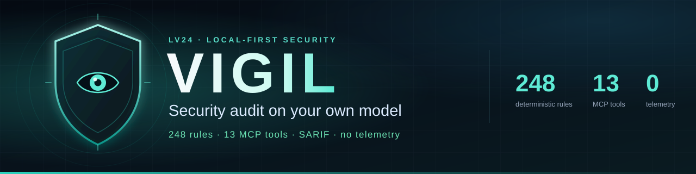

# lv24-vigil

[](https://www.npmjs.com/package/lv24-vigil)
[](https://www.npmjs.com/package/lv24-vigil)
[](https://github.com/LevapVeeskela/lv24-vigil/releases)
[](https://securityscorecards.dev/viewer/?uri=github.com/LevapVeeskela/lv24-vigil)
[](https://github.com/marketplace/actions/vigil-security-scan)
[](https://github.com/LevapVeeskela/lv24-vigil/blob/main/LICENSE)
[](https://github.com/LevapVeeskela/lv24-vigil/blob/main/docs/mcp.md)

**Vigil is a security auditor for your code that runs on your own model.** It
runs 263 deterministic rules over a repository, then optionally sends the minimum
context to the model you already pay for to triage findings, review risky code,
propose fixes and write a threat model. OpenAI, Anthropic, Gemini, OpenRouter,
Groq, DeepSeek, Mistral, xAI, OpenCode Go, Ollama, LM Studio, a local CLI or any
OpenAI-compatible endpoint.

The same binary is a CLI and a stdio MCP server for OpenCode, Claude Code, Codex
and Cursor. There is no Vigil account, no telemetry, no Docker for a normal scan
and no source file written by default. Deterministic findings never depend on an
LLM: a provider outage is a warning, not a failed scan.

## Install

```bash
npm i -g lv24-vigil
vigil version
```

Or run it without a global install:

```bash
npx -y lv24-vigil scan --no-llm
npx -y lv24-vigil mcp
```

Requires Node.js 18+. Nothing is downloaded at install time and no install
scripts run: the binary arrives as a regular npm dependency.

| Your machine | Package npm picks for you |
| --- | --- |
| Windows x64 / arm64 | `@lv24/vigil-win32-x64` / `@lv24/vigil-win32-arm64` |
| macOS Intel / Apple silicon | `@lv24/vigil-darwin-x64` / `@lv24/vigil-darwin-arm64` |
| Linux x64 / arm64 | `@lv24/vigil-linux-x64` / `@lv24/vigil-linux-arm64` |

**Install only `lv24-vigil`.** The six platform packages are
`optionalDependencies` selected by the launcher — never install them directly.
Keep optional dependencies enabled: `--no-optional` and `--omit=optional` leave
`vigil` without a binary.

| | Command |
| --- | --- |
| Update | `npm i -g lv24-vigil@latest` |
| Pin a release | `npm i -g lv24-vigil@0.11.0` |
| Remove | `npm uninstall -g lv24-vigil` |
| Check provenance | `npm view lv24-vigil dist.attestations` |

Every package is published from GitHub Actions through npm Trusted Publishing
(OIDC, no stored token) with a provenance attestation. Without Node.js, use
Homebrew, Scoop, a Linux package, the container or a release binary:
<https://github.com/LevapVeeskela/lv24-vigil/blob/main/docs/install.md>.

## 60-second quickstart

```bash
cd your-repo

vigil scan --no-llm          # deterministic rules only: no key, no network
vigil scan                   # add LLM triage (needs a provider key)
vigil status                 # resolved provider, model, rules and last scan
vigil rules                  # the authoritative rule catalog

vigil scan --format sarif --fail-on high > vigil.sarif
vigil review --base origin/main --format sarif --fail-on high
vigil fix VGL-XXXXXXXXXX --apply   # validated diff, never commits
```

Exit codes: `0` clean, `1` error, `2` findings at or above `--fail-on`.

## What you get

| Feature | What it does |
| --- | --- |
| **263 deterministic rules** | Secrets, injection, crypto, auth, web, config/IaC, CI, dependencies, MCP configuration and anti-RE hardening — no model required |
| **LLM triage and deep review** | Ranks findings and reads high-risk files with the model you configure |
| **Fix diffs and threat model** | A validated unified diff per finding; a STRIDE-style Markdown threat model |
| **MCP server** | 14 tools, 4 resources and 5 prompts over stdio |
| **Reports** | Markdown, JSON, SARIF 2.1.0, JUnit and self-contained HTML |
| **Baseline and inline suppression** | Accept a finding with a reason, ticket and expiry date |
| **Dependencies and SBOM** | Known advisories from OSV (opt-in network); CycloneDX 1.6 or SPDX 2.3, offline |
| **MCP config audit** | Unpinned server packages, literal secrets, cleartext endpoints, disabled TLS |
| **CI gate** | `--fail-on`, exit code `2`, SARIF upload, a GitHub Action and a GitLab template |

## Before commit / before deploy

```bash
vigil hook install                  # local pre-commit gate
vigil hook install --mode pre-push  # or before push
vigil scan . --no-llm --fail-on high # manual gate, no key, no network
```

The hook runs a deterministic changed-files scan and is marked
`# managed by lv24-vigil`; `--force` backs up a foreign hook instead of
clobbering it. GitHub Actions, GitLab CI, SARIF and the optional pre-check are
documented in
[Before commit / before deploy](https://github.com/LevapVeeskela/lv24-vigil#before-commit--before-deploy)
and [docs/ci.md](https://github.com/LevapVeeskela/lv24-vigil/blob/main/docs/ci.md).

## MCP server

Claude Code, Claude Desktop and Cursor (`mcpServers` shape):

```json
{
  "mcpServers": {
    "vigil": {
      "command": "npx",
      "args": ["-y", "lv24-vigil", "mcp"]
    }
  }
}
```

OpenCode (`opencode.json`):

```json
{
  "mcp": {
    "vigil": {
      "type": "local",
      "command": ["npx", "-y", "lv24-vigil", "mcp"],
      "enabled": true
    }
  }
}
```

Codex (`~/.codex/config.toml`):

```toml
[mcp_servers.vigil]
command = "npx"
args = ["-y", "lv24-vigil", "mcp"]
```

Claude Code one-liner: `claude mcp add vigil -- npx -y lv24-vigil mcp`.

| Tool | What it does | Needs |
| --- | --- | --- |
| `vigil_scan` | Deterministic scan with optional LLM triage | model optional |
| `vigil_review` | Reviews changed lines or a supplied diff | model optional |
| `vigil_explain` | Explains one finding and a fix direction | model |
| `vigil_fix` | Proposes a minimal diff; `apply=true` writes it | model |
| `vigil_threat_model` | STRIDE-style threat model | model |
| `vigil_hardening` | Release-hardening gaps, grouped by platform | offline |
| `vigil_mcp_audit` | Gaps in MCP server configs | offline |
| `vigil_dependencies` | Declared packages checked against OSV | network to OSV |
| `vigil_verify` | Re-checks whether a finding is still present | none |
| `vigil_baseline` | List, add, remove or clear accepted findings | baseline file |
| `vigil_report`, `vigil_history` | Render or list stored scans | local store |
| `vigil_status`, `vigil_rules` | Environment check and rule catalog | none |

The server also exposes four resources and five prompts. Only `vigil_fix` with
`apply=true` changes source files. Then ask the agent: *"Scan this repository
with Vigil and explain the top three findings."*

## For AI agents

```json
{
  "package": "lv24-vigil",
  "install": "npm i -g lv24-vigil",
  "binary": "vigil",
  "mcp": { "command": "npx", "args": ["-y", "lv24-vigil", "mcp"] },
  "mcp_registry_name": "io.github.LevapVeeskela/vigil",
  "deterministic_only": "vigil scan --no-llm",
  "json_report": "vigil scan --format json",
  "sarif": "vigil scan --format sarif --fail-on high",
  "status_json": "vigil status --json",
  "fix_dry_run": "vigil fix <finding-id>",
  "fix_apply": "vigil fix <finding-id> --apply",
  "writes_source_files": ["vigil fix --apply", "vigil_fix apply=true"],
  "exit_codes": { "0": "clean", "1": "error", "2": "findings at or above --fail-on" },
  "docs_index": "https://github.com/LevapVeeskela/lv24-vigil/blob/main/llms.txt"
}
```

1. Use `lv24-vigil`, not the platform packages.
2. Without a model, `--no-llm` still runs all 263 rules; a missing model is a
   warning, not a failure.
3. Read `--format json` or call an MCP tool; do not parse the human summary.
   Findings are in `findings`, accepted ones in `suppressed`, warnings in
   `errors`.
4. Show a fix diff before applying it. Vigil never commits or stages.
5. Exit code `2` is a policy failure, not a crash: report it, do not retry.

Tool arguments, the finding schema and the full contract:
[For AI agents](https://github.com/LevapVeeskela/lv24-vigil#for-ai-agents) ·
[llms.txt](https://github.com/LevapVeeskela/lv24-vigil/blob/main/llms.txt).

## Troubleshooting

| You see | What to do |
| --- | --- |
| `platform package ... is not installed` | Reinstall without `--no-optional` / `--omit=optional` |
| "LLM disabled" or `no LLM provider configured` | The deterministic scan still ran; set a provider key or pass `--no-llm` |
| Exit code `2` | Findings at or above `--fail-on`; fix, baseline or suppress them |
| No tools in the MCP client | `command` and `args` must be arrays; restart the client; try `["vigil", "mcp"]` after a global install |

More: [docs/troubleshooting.md](https://github.com/LevapVeeskela/lv24-vigil/blob/main/docs/troubleshooting.md).

## Links

- **Source and full README:** <https://github.com/LevapVeeskela/lv24-vigil>
- **Docs:** <https://github.com/LevapVeeskela/lv24-vigil/tree/main/docs>
- **Agent index:** <https://github.com/LevapVeeskela/lv24-vigil/blob/main/llms.txt>
- **Install options:** <https://github.com/LevapVeeskela/lv24-vigil/blob/main/docs/install.md>
- **MCP recipes:** <https://github.com/LevapVeeskela/lv24-vigil/blob/main/docs/mcp.md>
- **Providers:** <https://github.com/LevapVeeskela/lv24-vigil/blob/main/docs/providers.md>
- **Security model:** <https://github.com/LevapVeeskela/lv24-vigil/blob/main/docs/security-model.md>
- **Issues:** <https://github.com/LevapVeeskela/lv24-vigil/issues>
- **Changelog:** <https://github.com/LevapVeeskela/lv24-vigil/blob/main/CHANGELOG.md>

## If it helped you, star it

If this package was genuinely useful, please star the source repository:

**[Star LevapVeeskela/lv24-vigil on GitHub](https://github.com/LevapVeeskela/lv24-vigil)**

Stars raise the project's visibility for other people and AI agents, and they are a simple way to
thank the author. Humans and agents are both welcome to star.

Apache-2.0. No telemetry. A deterministic scan makes no network calls; the
only outbound requests are to the model endpoint you configure, to the OSV API
when you run `vigil dependencies` or enable `scan.osv`, and the explicit
`vigil precheck` upload.
