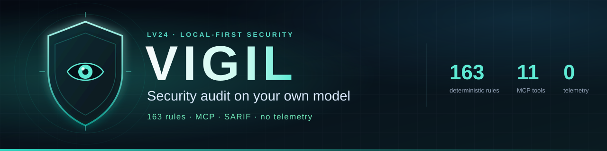

# lv24-vigil

[](https://www.npmjs.com/package/lv24-vigil)
[](https://www.npmjs.com/package/lv24-vigil)
[](https://github.com/marketplace/actions/vigil-security-scan)
[](https://github.com/LevapVeeskela/lv24-vigil/blob/main/LICENSE)
[](https://github.com/LevapVeeskela/lv24-vigil/blob/main/go.mod)
[](https://github.com/LevapVeeskela/lv24-vigil/blob/main/docs/mcp.md)

**Vigil is a security auditor for your code that runs on your own model.** It
runs 198 deterministic rules over a repository, then optionally sends the minimum
context to the model you already pay for to triage findings, review risky code,
propose fixes and write a threat model. OpenAI, Anthropic, Gemini, OpenRouter,
Groq, DeepSeek, Mistral, xAI, OpenCode Go, Ollama, LM Studio, a local CLI or any
OpenAI-compatible endpoint.

The same binary is a CLI and a stdio MCP server for OpenCode, Claude Code, Codex
and Cursor. There is no Vigil account, no telemetry, no Docker for a normal scan
and no source file written by default. Deterministic findings never depend on an
LLM: a provider outage is a warning, not a failed scan.

## Install

```bash
npm i -g lv24-vigil
vigil version
```

Or run it without a global install:

```bash
npx -y lv24-vigil scan --no-llm
npx -y lv24-vigil mcp
```

**Package choice.** Install only `lv24-vigil`. The six platform packages
(`@lv24/vigil-win32-x64`, `@lv24/vigil-darwin-arm64`, `@lv24/vigil-linux-x64`,
…) are `optionalDependencies` selected by the launcher — never install them
directly. Keep optional dependencies enabled: `--no-optional` and
`--omit=optional` leave `vigil` without a binary. Nothing is downloaded at
install time and no install scripts run. Update with
`npm i -g lv24-vigil@latest`.

The npm package requires Node.js 18+. Without Node.js, use the Go install or a
standalone installer:
<https://github.com/LevapVeeskela/lv24-vigil/blob/main/docs/install.md>.

## 60-second quickstart

```bash
cd your-repo

vigil scan --no-llm          # deterministic rules only: no key, no network
vigil scan                   # add LLM triage (needs a provider key)
vigil status                 # resolved provider, model, rules and last scan
vigil rules                  # the authoritative rule catalog

vigil scan --format sarif --fail-on high > vigil.sarif
vigil review --base origin/main --format sarif --fail-on high
vigil fix VGL-XXXXXXXXXX --apply   # validated diff, never commits
```

Exit codes: `0` clean, `1` error, `2` findings at or above `--fail-on`.

## Before commit / before deploy

```bash
vigil hook install                  # local pre-commit gate
vigil hook install --mode pre-push  # or before push
vigil scan . --no-llm --fail-on high # manual gate, no key, no network
```

The hook runs a deterministic changed-files scan and is marked
`# managed by lv24-vigil`; `--force` backs up a foreign hook instead of
clobbering it. GitHub Actions, GitLab CI, SARIF and the optional pre-check are
documented in
[Before commit / before deploy](https://github.com/LevapVeeskela/lv24-vigil#before-commit--before-deploy)
and [docs/ci.md](https://github.com/LevapVeeskela/lv24-vigil/blob/main/docs/ci.md).

## MCP server

Claude Code, Claude Desktop and Cursor (`mcpServers` shape):

```json
{
  "mcpServers": {
    "vigil": {
      "command": "npx",
      "args": ["-y", "lv24-vigil", "mcp"]
    }
  }
}
```

OpenCode (`opencode.json`):

```json
{
  "mcp": {
    "vigil": {
      "type": "local",
      "command": ["npx", "-y", "lv24-vigil", "mcp"],
      "enabled": true
    }
  }
}
```

Codex (`~/.codex/config.toml`):

```toml
[mcp_servers.vigil]
command = "npx"
args = ["-y", "lv24-vigil", "mcp"]
```

Claude Code one-liner: `claude mcp add vigil -- npx -y lv24-vigil mcp`.

The server exposes 11 tools (`vigil_scan`, `vigil_review`, `vigil_explain`,
`vigil_fix`, `vigil_threat_model`, `vigil_status`, `vigil_rules`,
`vigil_baseline`, `vigil_report`, `vigil_verify`, `vigil_history`), four
resources and three prompts. Only `vigil_fix` with `apply=true` changes source
files. Then ask the agent: *"Scan this repository with Vigil and explain the top
three findings."*

## For AI agents

```json
{
  "package": "lv24-vigil",
  "install": "npm i -g lv24-vigil",
  "binary": "vigil",
  "mcp": { "command": "npx", "args": ["-y", "lv24-vigil", "mcp"] },
  "deterministic_only": "vigil scan --no-llm",
  "json_report": "vigil scan --format json",
  "status_json": "vigil status --json",
  "exit_codes": { "0": "clean", "1": "error", "2": "findings at or above --fail-on" },
  "docs_index": "https://github.com/LevapVeeskela/lv24-vigil/blob/main/llms.txt"
}
```

Use `lv24-vigil`, not the platform packages. If no model is configured,
`--no-llm` still runs all 198 rules. Prefer `--format json` or MCP over parsing
the human summary. Show a fix diff before applying it.

## Links

- **Source and full README:** <https://github.com/LevapVeeskela/lv24-vigil>
- **Docs:** <https://github.com/LevapVeeskela/lv24-vigil/tree/main/docs>
- **Agent index:** <https://github.com/LevapVeeskela/lv24-vigil/blob/main/llms.txt>
- **Install options:** <https://github.com/LevapVeeskela/lv24-vigil/blob/main/docs/install.md>
- **MCP recipes:** <https://github.com/LevapVeeskela/lv24-vigil/blob/main/docs/mcp.md>
- **Providers:** <https://github.com/LevapVeeskela/lv24-vigil/blob/main/docs/providers.md>
- **Issues:** <https://github.com/LevapVeeskela/lv24-vigil/issues>
- **Changelog:** <https://github.com/LevapVeeskela/lv24-vigil/blob/main/CHANGELOG.md>

Apache-2.0. No telemetry: only the model endpoint you configure is contacted.
