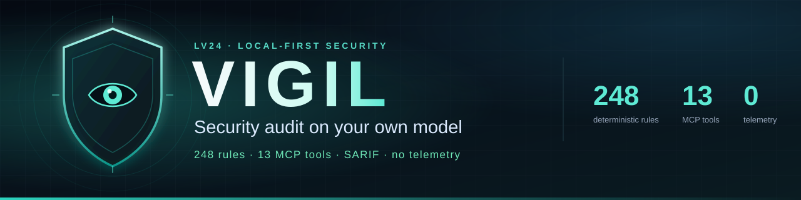

# lv24-vigil (Python launcher)

[](https://pypi.org/project/lv24-vigil/)
[](https://pypi.org/project/lv24-vigil/)
[](https://www.npmjs.com/package/lv24-vigil)
[](https://github.com/LevapVeeskela/lv24-vigil/blob/main/LICENSE)
[](https://github.com/LevapVeeskela/lv24-vigil/blob/main/docs/mcp.md)

**Vigil is a local-first security auditor for code.** It runs 263 deterministic
rules over a repository (secrets, injection, crypto, auth, web, config/IaC, CI,
dependencies, MCP configuration, release hardening) and can then use the model
you configure to triage findings, propose fixes and write a threat model. The
same program is a CLI and a stdio MCP server. No account, no telemetry.

This package is a **thin launcher**: the `vigil` command delegates to the npm
package [`lv24-vigil`](https://www.npmjs.com/package/lv24-vigil) through `npx`.
It does not reimplement Vigil and bundles neither a binary nor Node.js.

```text
 vigil (this package)  -->  npx -y lv24-vigil@<version>  -->  the Vigil binary
```

## Prerequisites

- **Node.js 18 or newer**, including npm and npx
  ([nodejs.org](https://nodejs.org/)).
- Python 3.9 or newer.
- Network access on first run, or an npm cache that already contains the
  requested package, because `npx` may download it.

No Node.js? Use Homebrew, Scoop, a Linux package, the container or a release
binary instead:
<https://github.com/LevapVeeskela/lv24-vigil/blob/main/docs/install.md>.

## Installation

```bash
pipx install lv24-vigil        # isolated, recommended for a CLI
pip install lv24-vigil         # into the current environment
uvx lv24-vigil scan --no-llm   # run once without installing
```

This installs two equivalent console scripts, `vigil` and `lv24-vigil`.

| | Command |
| --- | --- |
| Update | `pipx upgrade lv24-vigil` or `pip install -U lv24-vigil` |
| Remove | `pipx uninstall lv24-vigil` or `pip uninstall lv24-vigil` |

## Usage

```bash
vigil version
vigil scan --no-llm                          # deterministic rules: no key, no network
vigil scan --format sarif --fail-on high     # CI gate, SARIF on stdout
vigil status --json                          # resolved provider, model and rules
```

All arguments are forwarded unchanged to the npm CLI. The child process
inherits the terminal, environment and working directory, and its exit code is
propagated. You can also run:

```bash
python -m lv24_vigil --help
```

| Exit code | Meaning |
| --- | --- |
| `0` | Clean |
| `1` | Error |
| `2` | Findings at or above `--fail-on` |
| `127` | `npx` was not found; the launcher prints an installation hint |
| `130` | Interrupted |

## MCP server

The launcher passes stdio through, so it can start the MCP server for a client
that only has Python tooling:

```json
{
  "mcpServers": {
    "vigil": {
      "command": "uvx",
      "args": ["lv24-vigil", "mcp"]
    }
  }
}
```

With Node.js on the machine anyway, `npx -y lv24-vigil mcp` is the direct form.
Clients, tools and prompts:
<https://github.com/LevapVeeskela/lv24-vigil/blob/main/docs/mcp.md>.

## Version pinning

By default the launcher runs the npm package version matching its own version
(currently `0.11.0`). Override it with `VIGIL_NPM_VERSION` to use any npm version
or tag:

```bash
VIGIL_NPM_VERSION=latest vigil --help
VIGIL_NPM_VERSION=0.11.0 vigil scan --no-llm
```

PowerShell:

```powershell
$env:VIGIL_NPM_VERSION = "latest"; vigil --help
```

## For AI agents

```json
{
  "package": "lv24-vigil",
  "install": "pipx install lv24-vigil",
  "requires": ["python>=3.9", "node>=18"],
  "binary": "vigil",
  "mcp": { "command": "uvx", "args": ["lv24-vigil", "mcp"] },
  "deterministic_only": "vigil scan --no-llm",
  "json_report": "vigil scan --format json",
  "status_json": "vigil status --json",
  "version_override_env": "VIGIL_NPM_VERSION",
  "exit_codes": { "0": "clean", "1": "error", "2": "findings at or above --fail-on", "127": "npx not found", "130": "interrupted" },
  "docs_index": "https://github.com/LevapVeeskela/lv24-vigil/blob/main/llms.txt"
}
```

Prefer `--format json` or an MCP tool over the human summary. Without a model,
`--no-llm` still runs all 263 rules. Show a fix diff before applying it.

## Links

- Main repository and documentation:
  <https://github.com/LevapVeeskela/lv24-vigil>
- Installation options:
  <https://github.com/LevapVeeskela/lv24-vigil/blob/main/docs/install.md>
- PyPI publishing and Trusted Publishing:
  <https://github.com/LevapVeeskela/lv24-vigil/blob/main/docs/pypi.md>
- Agent index:
  <https://github.com/LevapVeeskela/lv24-vigil/blob/main/llms.txt>
- Issues:
  <https://github.com/LevapVeeskela/lv24-vigil/issues>
- npm package:
  <https://www.npmjs.com/package/lv24-vigil>

## License

Apache-2.0, same as the Vigil repository and the canonical npm package.
